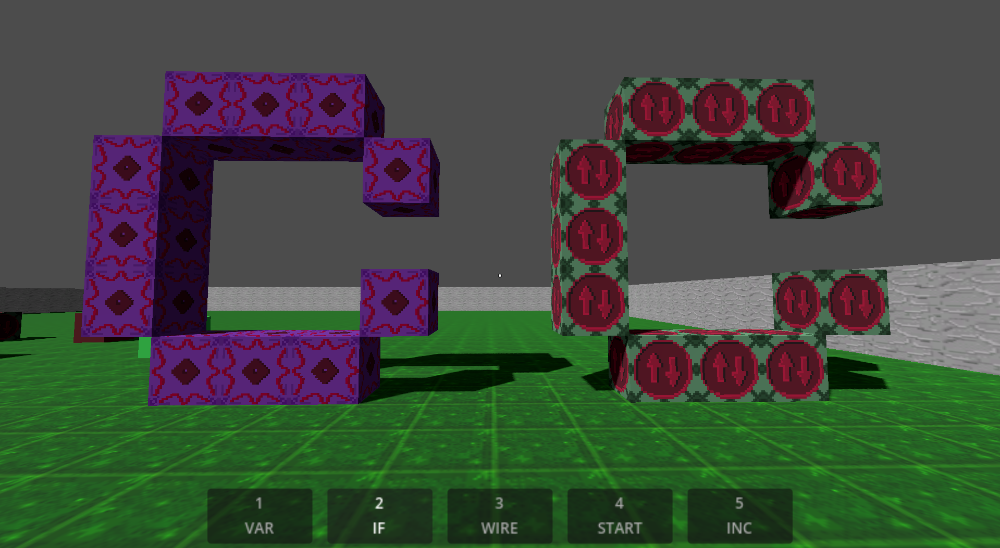
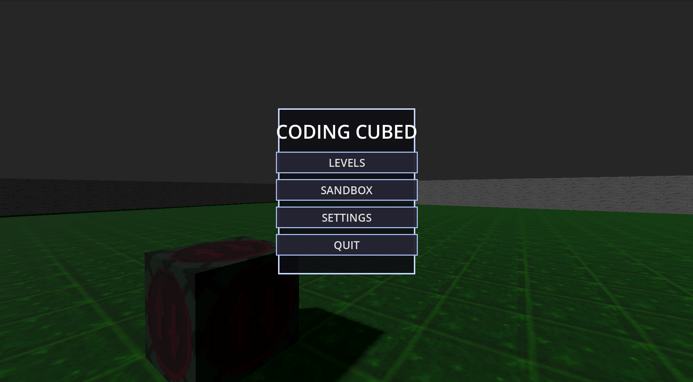
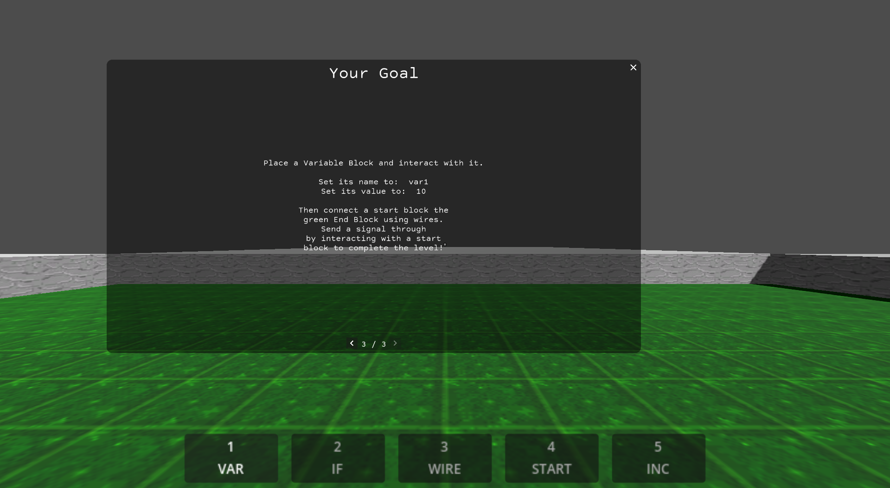
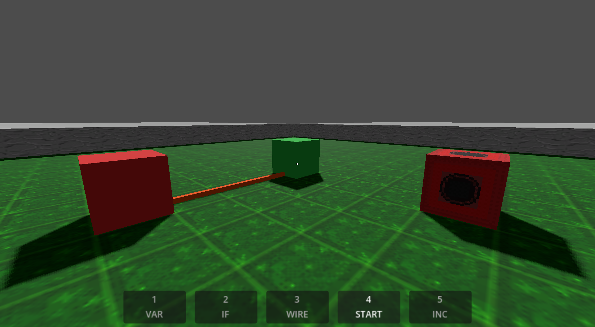

In Coding Cubed, you learn programming by building with blocks that act like code. You place variable blocks, if blocks, and incrementers, wire them together, and trigger them with a signal. The levels start with variable assignment, move on to conditionals, and end with a for loop. We made it as a team of four for our software engineering course, and you can [play it on itch.io](https://tehlamo.itch.io/coding-cubed).

<iframe
  src="https://www.youtube-nocookie.com/embed/mUQ4snO4LCs"
  title="NavigAid demo video"
  loading="lazy"
  allow="encrypted-media; picture-in-picture; web-share"
  referrerpolicy="strict-origin-when-cross-origin"
  allowfullscreen
  style="width: 100%; aspect-ratio: 16 / 9; border: 0; border-radius: 0.75rem;"
></iframe>

I built the UI, player movement, and how the player interacts with blocks. That included the variable block's editing menu, the signal flow through wires, and the first level with in-game tips. I also wrote some of the tests, and helped set up the GitHub Actions pipeline that exports the game for Windows and macOS and publishes it to itch.io.

