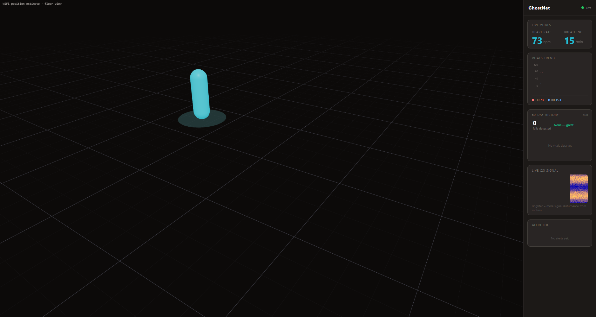
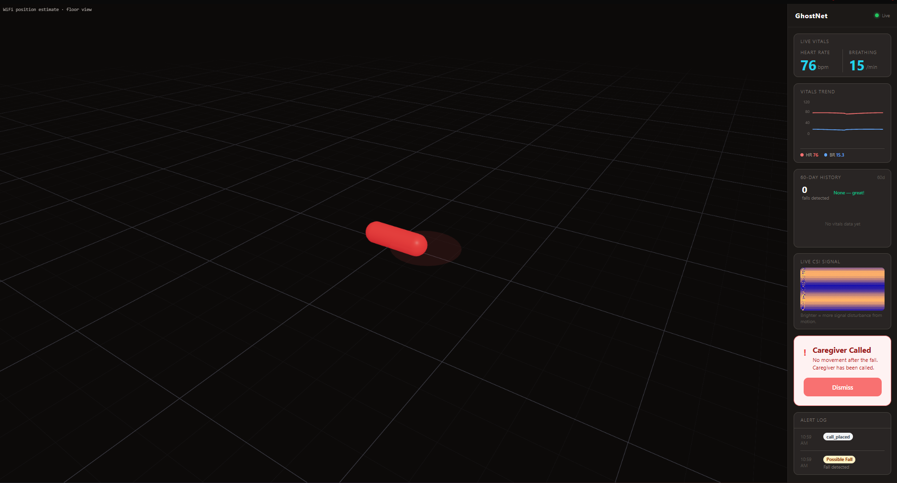

## Overview

My grandma falls a lot around the house, and I wanted a way to know when it happens without putting cameras in her home. GhostNet uses WiFi instead. Two ESP32-S3 boards send WiFi signals across a room and record how those signals change, which is called channel state information (CSI). Walking, falling, and even breathing change the signal in ways a model can learn. Some home WiFi systems already sell motion sensing based on the same idea, so someday this could run on hardware a family already owns. We built it as a team of three at QuackHacks 3.0.

<iframe
  src="https://www.youtube-nocookie.com/embed/GSPy-rk8NPo"
  title="NavigAid demo video"
  loading="lazy"
  allow="encrypted-media; picture-in-picture; web-share"
  referrerpolicy="strict-origin-when-cross-origin"
  allowfullscreen
  style="width: 100%; aspect-ratio: 16 / 9; border: 0; border-radius: 0.75rem;"
></iframe>

## My role

I built the heart and breathing rate side. There was no labeled data for our boards, so I made my own. I tracked my heart rate and breathing rate while the boards recorded me, generated extra labels from the raw signal with filtering and frequency analysis, and trained an LSTM in PyTorch to estimate both rates. I also trained the fall detection CNN on data we recorded by falling and walking around in front of the boards.

## What went wrong

The live demo failed, and we didn't place. The room was packed, and our ESP32 boards weren't good enough to track that many people at once.

## What I'd do differently

I'd do more research on data collection before the event, and either find datasets recorded on chips like ours or bring better hardware. I'd also try to demo somewhere less crowded. A crowded room broke my demo twice that month, here and at [NavigAid](/projects/smartcane/).
