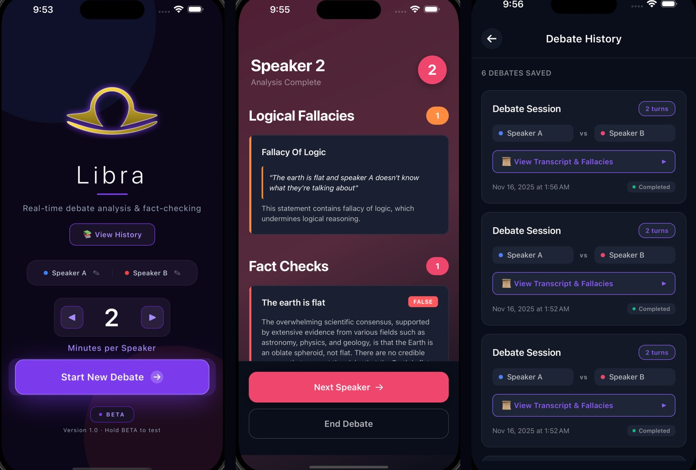
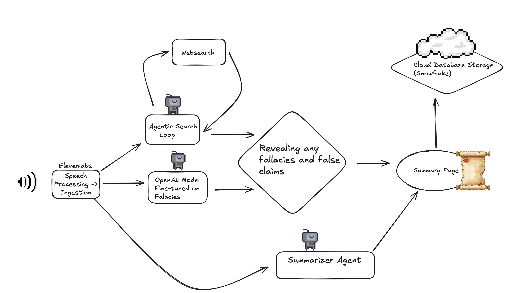

## Overview

We got the idea for Libra from watching Charlie Kirk debate college students across the country. A lot of those debates came down to false arguments and personal attacks, which ruined the point of debating and were polarizing the country. We didn't want Libra to be a way to bash the other side. We wanted it to get people to think more carefully about how they argue.

Libra is a debate coach app my team of four built at QuackHacks 2.0. Two people pass one phone back and forth and take timed turns, and they pick how many minutes each turn lasts. The app transcribes each turn, flags logical fallacies, fact-checks claims with sources, and writes a summary of both sides at the end. It also saves every debate, so you can go back and reread the transcript and the fallacies it found. The [Libra repo](https://github.com/dalmartin/libra) is on my teammate Daniel's GitHub.

*Libra at QuackHacks 2.0. Left to right: the home screen, the analysis after a turn, and the debate history.*

<iframe
  src="https://www.youtube-nocookie.com/embed/IwSIi-H4tg0"
  title="Libra demo video"
  loading="lazy"
  allow="encrypted-media; picture-in-picture; web-share"
  referrerpolicy="strict-origin-when-cross-origin"
  allowfullscreen
  style="width: 100%; aspect-ratio: 16 / 9; border: 0; border-radius: 0.75rem;"
></iframe>

## My role

I built the fallacy detector. I started with a scikit-learn classifier, but it made the model more complex than it needed to be, so I switched to fine-tuning an OpenAI model on the [LOGIC dataset](https://github.com/causalNLP/logical-fallacy), which is a set of sentences labeled by fallacy type. The detector sends the whole passage with every sentence numbered in one request, because whether a sentence is a fallacy often depends on the sentences around it. For each sentence, the model picks one of 13 fallacy types, like ad hominem or false dilemma, or "none," and gives a confidence score.

In Libra, I wrote the backend code that calls the fine-tuned model, plus the two Flask endpoints the app uses to send it audio or text. My teammate Zheng then rewrote the prompt to match how I trained the model and turned its results into the cards the app shows. My teammates built the rest of the app.

*How Libra works. My part is the fine-tuned OpenAI model in the middle.*

Fallac-Machine is my own repo for the model, so anyone can run it locally with their own OpenAI API key. It also returns the exact characters where each fallacy appears, and it has a FastAPI service with an `/analyze` endpoint so other apps can send it text.

## What I'd do differently

I never measured how much better the fine-tuned model was than my scikit-learn version. Right now the only evidence the switch helped is that the outputs looked better to me. Next I want to score both on the same held-out set, with accuracy and F1 for each fallacy type.
