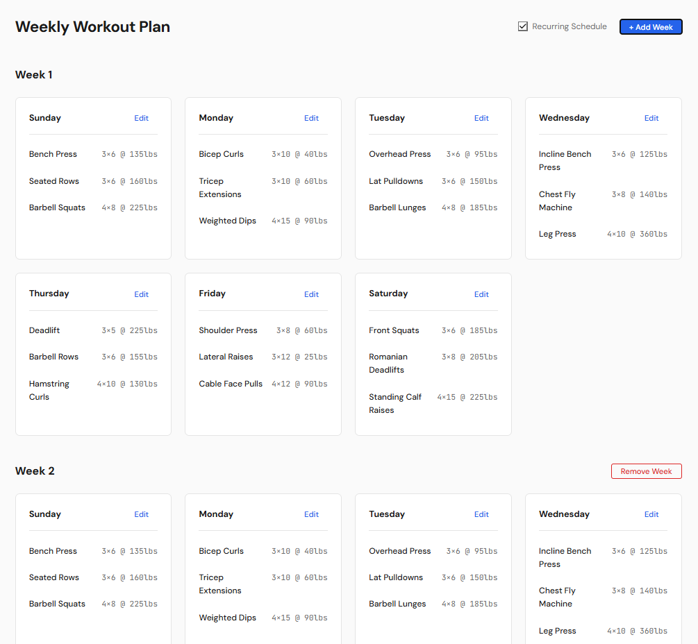
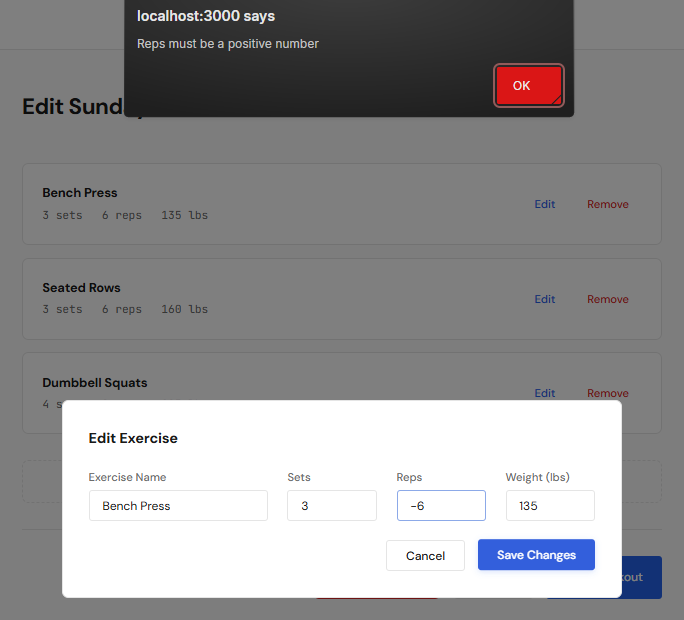

## Overview

Lift Log is a workout tracker where you plan your week, log your sets and reps, look back through your history, and track personal records. We built it as a team of seven for our software engineering course, working in one- to two-week sprints, and it got the top score in the class.

## My role

I owned the accounts part of the project: signing up, logging in, and changing your password. I designed the activity diagrams for its test cases and wrote the user model with my teammate Ankit. Passwords get hashed with bcrypt before they're stored, so the database never holds a real password. Ankit then built the login on top of it.

On the frontend, I made the weekly planner hold more than one week, with buttons to add and remove weeks. I wrote the class the planner uses to send its requests to the backend, too.

*The weekly planner with two weeks. Week 2 matches Week 1 because the recurring schedule is turned on.*

I also added a way to edit the exercises in a workout. Sets and reps have to be above zero and weight can't be negative, so you can't save a plan with numbers that don't make sense.

*Trying to save -6 reps gets blocked.*
