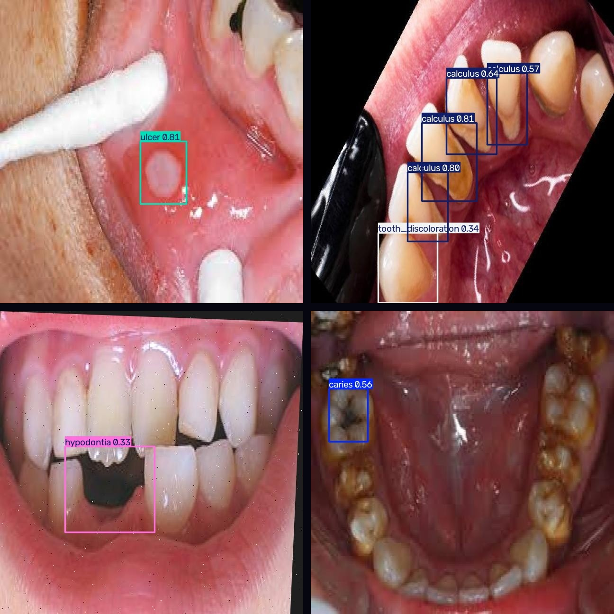

## Problem

ODAM detects six oral diseases in photos of the mouth: caries (cavities), gingivitis, tooth discoloration, ulcers, calculus (tartar), and hypodontia (missing teeth). I want low-income families who can't easily get to a dentist to get an early warning from a phone photo, so they can start taking better care of their teeth sooner. It's a screening aid. It doesn't replace a dentist.

*Predictions from my clean baseline on test photos. Top left: ulcer (0.81). Top right: calculus (0.57 to 0.81) and tooth discoloration (0.34). Bottom left: hypodontia (0.33). Bottom right: caries (0.56). The numbers are how confident the model is in each box.*

## My role

I built a four-stage data pipeline that combines eight separately labeled datasets into one training set. Each stage is its own script, run in order:

1. Remap each dataset's labels to the six shared classes, and throw out labels that don't fit, like plaque.
2. Merge everything into one folder, keeping only images that have a matching label file.
3. Split the data into train, validation, and test sets (70/15/15). Every augmented copy of a photo goes to the same split, and a saved manifest locks the test set so every model gets evaluated on the same photos.
4. Verify label formats and class counts, and check that no photo shows up in more than one split.

I also trained and evaluated every model, and wrote the scripts that find and fix problems in the data.

## Approach

I pulled eight datasets, seven from Roboflow and one from Zenodo. One of them is just healthy teeth, so the model learns what a healthy mouth looks like. I went through the data to check for duplicates. The Zenodo dataset came without a list of its class names, so I figured out its two classes (caries and missing tooth) and mapped them by hand in Stage 1. Stage 1 also converts the outline-style labels from some Roboflow downloads into the bounding boxes YOLO11 trains on.

I picked the diseases that are most common and easiest to see, so the model isn't trying to learn things you can't really spot in a photo.

The first version of ODAM used Faster R-CNN with a ResNet-50 backbone, which I built and trained in PyTorch. For version 2, I rebuilt it around YOLO11, because it has data augmentation built in, exports to a single ONNX file for deployment, and runs about 10 times faster per image. Most of my datasets came from Roboflow, which already exports labels in YOLO format, so YOLO11 reads them with no conversion.

I train it with the Ultralytics Python package, which handles the training loop and evaluation. My main setup is the medium model (YOLO11m), trained for up to 300 epochs with a batch size of 32 and the AdamW optimizer. Training stops early if the validation score hasn't improved in 50 epochs.

Training runs on Oregon State's High Performance Computing (HPC) cluster through SLURM job scripts. A full 300-epoch run takes around 7 hours. My clean baseline stopped early at epoch 136 and took 2.6 hours.

## Result

My first full run with YOLO11m scored 0.814 mAP50 on the validation set. That seemed too good, since the only things I'd changed from earlier runs were the bigger model and training for 300 epochs. At first I thought it was overfitting. It was data leakage. Roboflow exports several augmented copies of each photo, and my split had scattered copies of the same photo across train, validation, and test, so the model was getting scored on photos it had already seen.

I rewrote the split to keep every copy of a photo in the same set, added a leak check to the verify stage, and wrote an HPC job that scores every model the same way on the test set. Validation dropped from 0.814 to 0.665 mAP50, and the test set scored 0.674. Then I saved the split to a manifest that locks the test set, so every later experiment is compared on exactly the same photos.

At that point, calculus looked like the weak class. It scored 0.395 AP50, while the other five classes scored between 0.53 and 0.86. Only about 233 unique training photos have calculus in them, and a lot of teeth with visible tartar have no label at all, including in the test set. So when the model finds tartar nobody labeled, it gets marked wrong, and the calculus score isn't reliable.

To tell real improvements apart from noise, I retrained with only the random seed changed. Single classes moved by up to 0.04 AP50, but the average of the five non-calculus classes only moved by 0.003, so that average is what I compare experiments on. I ran this check before I found the duplicates below, so I still need to redo it on the clean data.

Then I wrote a duplicate finder that compares images by what's in them instead of their file names. It found that 319 of the 928 test photos (34%) had a near-identical copy in the training set under a different dataset or file name, because several of the Roboflow datasets share photos. I removed the 788 duplicate photos from the training set and retrained a clean baseline.

The test score dropped from 0.666 to 0.430 mAP50. Gingivitis fell the most, from 0.748 to 0.124 AP50, and caries, ulcer, and tooth discoloration each dropped by 0.2 to 0.3. Those classes come mostly from the datasets that shared photos. Hypodontia and calculus come mostly from other datasets, and they barely moved. So most of the old scores came from the model recognizing photos it had already seen, not from finding disease in new ones. These are my first honest numbers, and the model isn't good enough to use yet. My duplicate finder is strict on purpose, so a few near-copies could still be in the training set, and these numbers might still be a little high.

| Run | Validation mAP50 | Test mAP50 | What was wrong |
| --- | --- | --- | --- |
| First run | 0.814 | Not recorded | Copies of the same photo in more than one split |
| Grouped split | 0.665 | 0.674 | Same photos shared across datasets (found later) |
| Plaque removed | 0.674 | 0.666 | Same photos shared across datasets (found later) |
| Clean baseline (current) | 0.416 | 0.430 | A few near-copies might still be left |

## What I'd do differently

I'd compare photos by their content from day one. Both leaks came from the same photo showing up under a different name, and catching that early would have saved me several training runs.

I'd also get expert-labeled data, especially for calculus. I thought about relabeling the test photos myself, but I don't have dental training, so my labels could just add new errors.

Next, I'm adding more data, especially for gingivitis and tooth discoloration. I'll add one dataset at a time and check each one for duplicates against the validation and test sets first. Once the model is good enough, I want to build a live demo so it can detect diseases in real time.

I also learned that training a model doesn't take weeks like I thought. A training run takes hours. Most of the time goes into reading papers, finding the right model and training methods, and solving data problems I didn't know existed.

## Image credits

The photos in the grid come from public Roboflow Universe datasets, licensed under [CC BY 4.0](https://creativecommons.org/licenses/by/4.0/). I added the boxes and labels by running my model on them.

- Ulcer and caries: ["calculus" (v1)](https://universe.roboflow.com/ashvikha/calculus-7eza2/dataset/1) by ashvikha
- Calculus and tooth discoloration: ["Calculus" (v1)](https://universe.roboflow.com/dental-iex5i/calculus-tzg18/dataset/1) by dental-iex5i
- Hypodontia: ["oral-diseases" (v2)](https://universe.roboflow.com/gilang-pappa-tanto-pambua-zplqr/oral-diseases-rmzuw/dataset/2) by gilang-pappa-tanto-pambua-zplqr
